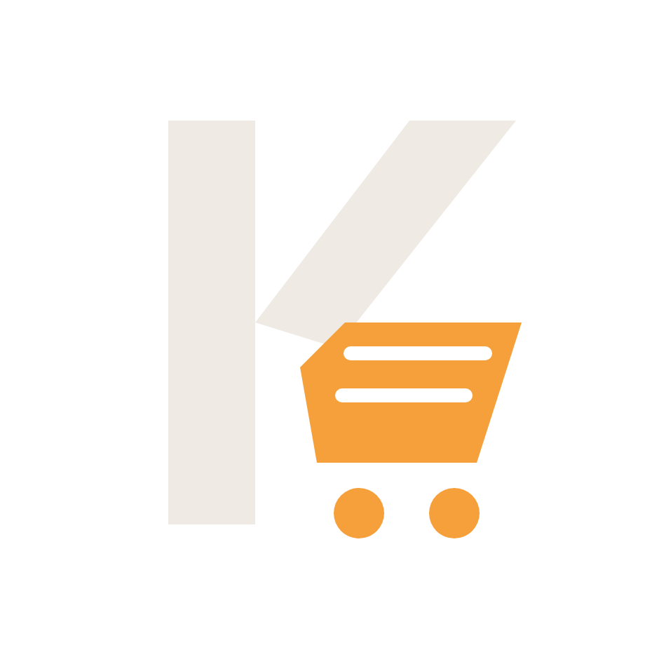

# KartKraft

We build and run online stores for Indian brands, and make sure the money side works.

## What we do

- **Storefronts:** fast, mobile-first shops in English and Hindi, with search, size and colour choices, wishlists and reviews.
- **Checkout and payments:** Razorpay with UPI, cards, netbanking and cash on delivery. Totals are computed on the server and every payment is verified with Razorpay before an order ships.
- **Orders and stock:** stock that can't oversell, refunds and cancellations that actually return the money, and an admin panel for products, orders and customers.
- **Rules done right:** GST invoices, the details Indian law asks every product page to show (MRP, country of origin, manufacturer), clear return and delivery policies, and customers' data handled under the DPDP Act.
- **Hosting:** AWS in Mumbai, close to your customers, with backups and monitoring.

## How we work

Every store change is reviewed and tested before it ships. Money paths (checkout, payment confirmation, refunds, stock) have automated tests that try to break them: two customers buying the last item at once, a payment confirmed twice, a webhook that arrives late.

## Team

- [Harsh Singh](https://github.com/singhharsh1708)
- [Abhi](https://github.com/abhijhacodes)

📍 India
